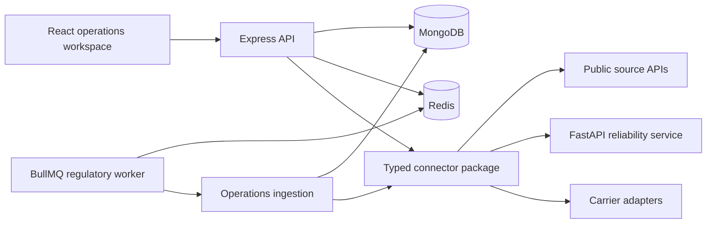

# Architecture and boundaries

VitaLink is an npm workspace with an Express API, React web app, BullMQ worker and a separate FastAPI numerical service. MongoDB stores domain records; Redis supports queues, cache, token revocation and temporary carrier raw-response archives.

## Processes

| Process | Entry                                                 | Responsibility                                                                               |
| ------- | ----------------------------------------------------- | -------------------------------------------------------------------------------------------- |
| API     | `apps/api/src/main.ts` → `app.ts` → `routes/index.ts` | Configuration, middleware, authenticated routes and service composition                      |
| Worker  | `apps/workers/src/main.ts`                            | Registers regulatory ingestion, initial refresh and hourly schedule; reports heartbeat       |
| Web     | `apps/web/src/main.tsx` → `App.tsx`                   | Session lifecycle and default connected operations workspace; earlier tools remain reachable |
| Brain   | `apps/brain/app/main.py`                              | Stateless numerical calculations; shared-secret enforcement in production                    |

The worker currently registers the operations ingestion queue. Comments describing future cascade and quote queue consumers do not mean those consumers are running.

## API module layout

Routes attach authentication/scopes and input schemas. Controllers adapt HTTP input/output. Services orchestrate domain calculations, other modules and repositories. Repositories own database access. `domain/` contains deterministic calculations and matching; `models/` contains storage schemas. Public `index.ts` files provide module interfaces.

- `auth`: organisations, users, roles, password rules, RS256 access tokens and refresh cookies.
- `catalog`: source retrieval, product assembly, label storage requirements and redundancy proxies.
- `signals`: raw evidence, clustering, independence, corroboration, veracity and quarantine.
- `graph`: catalogue-backed node/edge assembly and persisted graphs.
- `cascade`: conditional shock propagation, path exposure and supply-cover projection.
- `logistics`: consignment requirements, hard eligibility gates, scores and recommendations.
- `scenarios`: bounded sourcing × logistics enumeration, outcome terms and Pareto selection.
- `operations`: public incidents and the organisation's connected investigation workflow.
- `health`: process/dependency health endpoints.

The operations response planner and earlier scenarios engine are distinct implementations with distinct inputs. The connected planner is not evidence that all original scenario-engine features share one storage object.

## Shared packages

- `contracts`: Zod schemas shared by processes; provenance and quantity boundaries.
- `connectors`: typed public-source clients, cache/retry/rate limits, compressed-body validation, reliability HTTP client and carrier adapters. All external HTTP goes through this boundary.
- `graph`: graphology representation, traversal and metrics.
- `ui`: reusable React controls, layout, charts and quantity/provenance rendering.

Static import edges appear in [file notes](FILE_INDEX.md). Cross-process HTTP and storage relationships are described here because they cannot be inferred from imports alone.

## Data isolation and consistency

Public incident records can be shared across organisations. Investigations, watches, recommendations and decisions are organisation scoped; identity and permissions are enforced by existing middleware. Source snapshots remain attached to cases. Case writes check `updatedAt` to detect concurrent edits. Reanalysis clears plans and linked results tied to the old medicine analysis.

A coherent graph is rebuilt for the selected catalogue/trace context; cached cascade results include input fingerprints. Static graph links establish product/ingredient/labeler association, not observed physical production flow. Upstream shocks are conditional inputs.

Brain requests carry a service secret from the server. Keys, refresh tokens and raw carrier payloads must not appear in browser responses, context notes or public exports. Temporary carrier archives expire; a retained reference is not a permanent evidence archive. These limits matter before production live quoting.

For an end-to-end request, read [workflows](05_FEATURE_WORKFLOWS.md), then follow its source links from [the index](FILE_INDEX.md).
